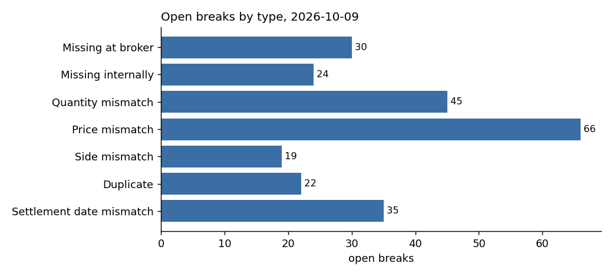
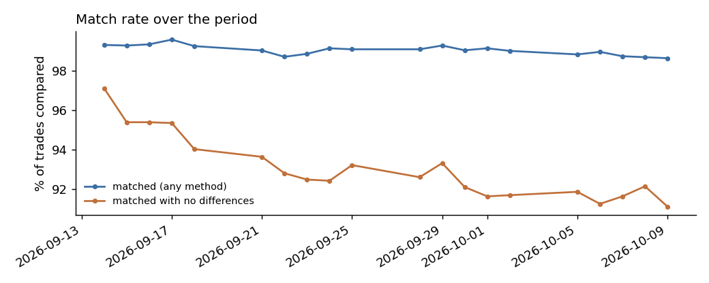

# Trade Reconciliation Tool

Every day a firm's own record of its trades (the **blotter**) has to agree with what its brokers say happened. This tool matches the two, finds every trade where they disagree (a **break**), labels it with one of seven break types, and ranks it for a Trade Support analyst to chase.

> **All data is synthetic.** The trades are generated by the tool, with errors planted on purpose and recorded in an answer key. That is what makes the accuracy numbers below checkable. Instrument names are real tickers; prices are approximate levels used only as a starting point for a random walk.

**Stack:** Python 3.12 (pandas) for generation and matching · PostgreSQL 16 (Docker) for storage and reporting views · pytest · matplotlib for the two charts.

## Results (20 business days, 40,000 trades, seed 20261016)

| Planted breaks | Detected | Missed | False positives | Recall | Precision | Lifecycle accuracy |
|---|---|---|---|---|---|---|
| 1,607 | 1,605 | 2 | 1 | **99.88%** | **99.94%** | 100% |

- Daily match rate: **98.6-99.6%**. About 5% of matches needed a fallback pass because the broker's trade_id was blank or mistyped.
- *Lifecycle accuracy* means each detected break closed on exactly the day the broker's fix arrived, or stayed open to the end if no fix was sent.
- Accuracy also holds above 99% on three other seeds (tested), so the matcher is not tuned to one dataset.
- Full breakdown: [reports/accuracy.md](reports/accuracy.md). Tolerance study: [reports/tolerance_sweep.md](reports/tolerance_sweep.md).

## Quick start

```bash
docker compose up -d --wait          # PostgreSQL on localhost:5433 (user/pass/db: recon)
pip install -r requirements.txt
python -m recon all                  # schema -> data -> 20 daily runs -> report -> accuracy -> sweep
python -m pytest                     # 39 tests (the DB test skips if Postgres is down)
```

Individual steps: `init-db`, `generate`, `run [--tolerance 0.0001]`, `report [--date 2026-10-01]`, `accuracy`, `sweep`.

## Break types

| Break type | Rule | Example | Severity | Suggested owner |
|---|---|---|---|---|
| Missing at broker | In the blotter, not in the broker file | Trade booked, never confirmed | Medium | Trade Support - chase the broker |
| Missing internally | In the broker file, not in the blotter | Broker shows a trade nobody booked | High | Trade Support - check with the desk |
| Quantity mismatch | Same trade, different quantity | 1,000 booked, 100 confirmed | High | Trade Support |
| Price mismatch | Price differs beyond tolerance (1bp) | 101.25 booked, 101.52 confirmed | Low, or Medium if 1,000+ at stake | Trade Support, then the desk |
| Side mismatch | Buy against sell | Booked buy, confirmed sell | High | Trade Support - escalate quickly |
| Duplicate | Same trade appears twice | Broker confirmed it twice | Medium | Trade Support |
| Settlement date mismatch | Different settle_date | T+1 booked, T+2 confirmed | Medium | Settlements |

## How it works

```
data/instruments.csv
        │
generate.py ──► internal_trades   (clean blotter)
            ──► broker_trades     (damaged copy + later AMEND/CANCEL/late confirms)
            ──► answer_key        (every planted error; the matcher never reads it)
        │
pipeline.py, for each day:
   select_population ─► matcher.reconcile ─► breaks.score ─► breaks.apply_lifecycle
                        1 duplicate check
                        2 exact match on trade_id
                        3 price tolerance (1bp)
                        4 fuzzy match on economics (unique candidate only)
                        5 partial match (one field off, unique candidate)
                        6 classify leftovers as missing
        │
recon_runs · match_results · breaks  ──► SQL views ──► report.py (Markdown + 2 charts)
                                                   └─► accuracy.py (vs answer_key)
```

## Sample report (excerpt, 2026-10-09)

| Trades compared | Match rate | Clean match rate | Open breaks | Change | New | Resolved |
|---|---|---|---|---|---|---|
| 2,197 | 98.63% | 91.12% | 241 | +19 vs previous run | 74 | 55 |




Full page: [reports/break_report_2026-10-09.md](reports/break_report_2026-10-09.md)

## Known limitations

1. **Partial-pass false pairing (the 2 misses and the 1 false positive above).** A booked trade the broker never confirmed and an unbooked broker trade happened to share stock, day and settle date, and differed only on price. The partial pass paired them and raised one price break instead of the two real breaks. The partial pass exists because it recovers about 40 planted errors that would otherwise surface as 80 false "missing" breaks, so this is a deliberate trade-off.
2. **Exact twins stay unmatched.** If two internal trades are identical to the 4th decimal and the broker record has no trade_id, there is no safe way to choose. Both sides are reported as missing, by design.
3. **Matching is one-to-one.** Allocations and block trades (one broker fill against several internal bookings) are not handled.
4. **The data is synthetic.** Real broker files have format problems (CSV quirks, SWIFT MT515/MT518, FIX) that this tool does not parse.

## Documentation

- [docs/BUILD_GUIDE.md](docs/BUILD_GUIDE.md): how and why everything was built, module by module, including the build log of fixes and their effect on accuracy.
- [docs/INTERVIEW_PREP.md](docs/INTERVIEW_PREP.md): a pitch, a single trade walked through the system, numbers to remember, and answers to the questions you are likely to get.
